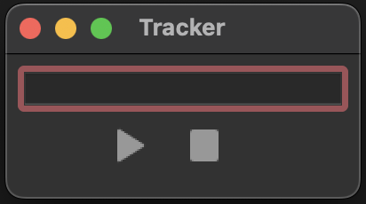

# Task Tracker Application

This is a task tracking application built with a FastAPI backend, PostgreSQL database, and a React frontend with TypeScript. The application allows users to track their tasks, record start and end times, and calculate the duration of each task. Additionally, users can see their tasks using a GraphQL API.

## Features
- **Task Tracking**: Start and stop tasks with a description via Desktop GUI.
- **Time Duration Calculation**: Automatically calculate the duration of tasks.
- **GraphQL API**: Query tasks within a specified time period.
- **React Frontend**: View and query tasks through a user-friendly web interface.

## Technologies Used

- **Backend**: Python 3.11.3, FastAPI, SQLAlchemy, PostgreSQL, Pydantic
- **Frontend**: React, TypeScript
- **GraphQL**: Graphene (Python library for GraphQL)
- **DesktopGUI**: Python 3.11.3, PyQT5

## Installation

1. **Clone the Repository**:

    ```bash
    git clone https://github.com/egor-bondarev/Tracker.git
    cd Tracker
    ```

2. **Configure and run the backend and PostgreSQL**:

    Copy `.env.example` to `.env` and set **different, nonempty**
    `DATABASE_ADMIN_PASSWORD` and `DATABASE_PASSWORD` values. Keep `.env` private.
    Docker Engine and the Compose plugin are required; host Python is not needed
    to initialize the database.

    ```bash
    cp .env.example .env
    chmod 600 .env
    # Edit .env before starting the stack.
    ```

    ```bash
    make run_tracker
    ```

3. **Run the React Application**:

    ```bash
    cd web_ui/tracker-client
    npm start
    ```
    Web UI will be available on http://localhost:3000

4. **Run Desktop GUI**:

    ```bash
    cd ../..
    cd ./desktop_gui
    python ./main.py
    ```
    

## Usage

1. On desktop GUI type your task description and press Start. 
2. After finishing your task press Stop.
3. If you forgot to start your task, you may type description and press Stop. In this case start time will be a finish time from your previous task.
4. To see your tasks list go to web ui (http://localhost:3000), set start and finish time by mask "YYYY-MM-DD hh:mm:ss" and click "Show Tasks".

### Architecture
#### **Record service:**
This service works with desktop gui and write data to database.

**API Endpoints:**

- **Start a new Task**: 
    ```
    POST /new/?is_task_finished=false
    ```

- **Finish started Task**: 
    ```
    POST /finish/
    ```

- **Start and Finish a new Task**: 
    ```
    POST /new/?is_task_finished=true
    ```

#### **Analytic service:**
This service works with web ui and show tasks list via GraphQL request.

**API Endpoints:**

- **Get Tasks from period**: 
```graphql
query GetTasksInPeriod($startDate: DateTime!, $endDate: DateTime!) {
    tasksInPeriod(start_date: $startDate, end_date: $endDate) {
        id
        description
        start_timestamp
        finish_timestamp
        duration
    }
}
```

## Run autotests

- **Run application**: 
    ```
    make run_tracker
    ```

- **Run component tests for record service**: 
    ```
    make record_service_component_tests
    ```

- **Run unit tests for record service**: 
    ```
    make record_service_unit_tests
    ```

- **Run all tests for record service**: 
    ```
    make record_service_all_tests
    ```

## Backend deployment (Ubuntu / WSL2)

`make run_tracker` uses `docker compose up -d --build`. Without Make, or when
Docker requires sudo, run `sudo docker compose up -d --build` directly.

Startup order: PostgreSQL health check → one-shot `db_init` → both APIs.
`db_init` exits with code 0 on success; it is not a continuously running service.
Database connection attempts are bounded so a configuration error fails visibly.
The initializer can be repeated without dropping existing tasks. It creates missing
roles/databases/tables, but does **not** migrate schemas or rotate existing passwords.

```bash
docker compose ps -a
docker compose logs db_init
curl --fail http://localhost:8000/openapi.json
curl --fail http://localhost:8001/openapi.json
```

The APIs listen on container ports 8000/8001; `.env` selects their host ports.
Inside Compose, database access is always `tracker_database:5432`.
`RECORD_SERVICE_HOST` and `ANALYTIC_SERVICE_HOST` are client settings, not container
listen addresses. PostgreSQL's host port defaults to `127.0.0.1:5454`, for local
tests only; it is not published to the LAN. WSL forwarding/firewall setup for LAN
access is a separate step. The React UI is still started separately as above.

PostgreSQL uses the official `postgres:17-bookworm` image and stores data in the
named volume `postgres17_data` at `/var/lib/postgresql/data`. The major version is
fixed; patch updates still follow the tag. `docker compose down` preserves data.
Do not use `down -v` for a deployment whose data you need.

### Switching from the old checkout

The old repository tracked `.env`; this branch removes it from Git. Before switching
branches, save your settings outside the checkout, with restricted permissions.
Then create a new `.env` from `.env.example`. Previously published credentials must
not be reused as deployment secrets; removing the file does not erase Git history.

This setup uses a **new volume** rather than reusing the old Bitnami `postgres_data`
volume. If the old deployment contains tasks, back it up and perform a logical
PostgreSQL dump/restore before switching. This branch does not automatically migrate
old data or change existing timestamp column types.

Docker restart policies restart the long-running containers when Docker starts.
They do not launch WSL at Windows boot; that must be configured separately. Compose
startup dependencies apply to Compose operations, not daemon-driven restarts.

### Initialization regression checks

With the record service dependencies installed:

```bash
python -m unittest discover -s tests -v
```

### Acer Windows startup

See [the Windows startup runbook](deployment/windows/README.md) for the WSL
keepalive task, port forwarding script, firewall rule and reboot verification.
Recovery after sleep/hibernation is still under investigation.
